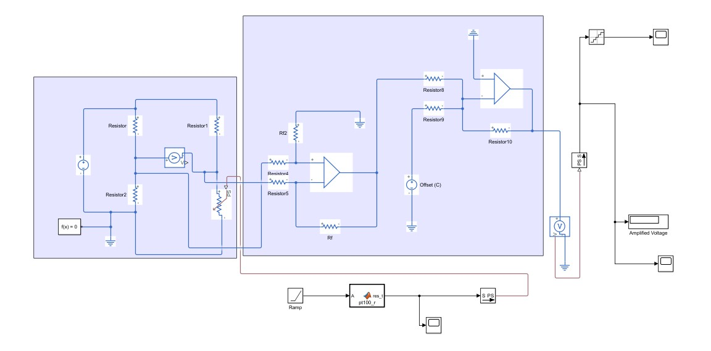
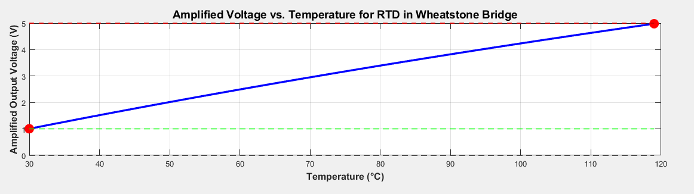
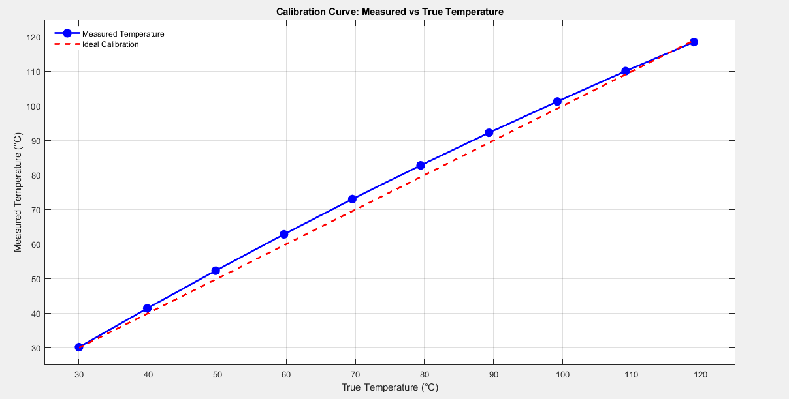
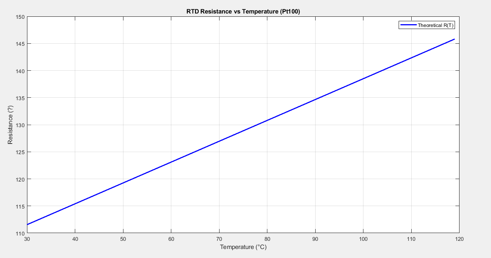

# RTD Temperature Data Acquisition System (Simulink)

Design and simulation of a precision temperature measurement chain for industrial use. The chain runs from a **Pt100 RTD sensor** through a **Wheatstone bridge** and an **op-amp measurement amplifier** to a **16-bit ADC**, covering **30 °C to 119 °C**. It is modelled in MATLAB/Simulink with Simscape Electrical.

> Final project for **MFA600 Mechatronics for Automation**, M.Sc. programme in AI and Automation at University West, Sweden (Fall 2025). Individual project.



## Signal chain

```
Temperature ──► Pt100 RTD ──► Wheatstone bridge ──► Difference amp ──► Offset stage ──► 16-bit ADC
 30–119 °C     111.7–145.7 Ω    0.276–0.930 V        gain 6.079         −0.671 V         1.00–4.98 V
```

| Stage | Implementation in the model |
|-------|-----------------------------|
| Temperature input | Ramp from 30 °C to 119 °C over 10 s |
| Sensor | MATLAB Function block (`pt100_r`) using the IEC 60751 Callendar–Van Dusen equation, which drives a variable resistor |
| Bridge | 10 V supply, R1 = R2 = R3 = 100 Ω, RTD in the fourth arm |
| Amplifier | Op-amp difference amplifier, Rf / Rin = 60.79 kΩ / 10 kΩ, giving **G = 6.079** |
| Offset | Second op-amp stage (1 kΩ resistors) that subtracts a **0.671 V** reference |
| ADC | Quantizer with a 76.29 µV step (**16-bit, 5 V reference**) |

## Design

**Sensor choice.** A Pt100 is accurate (±0.1–0.5 °C), stable and close to linear in the moderate 30–119 °C range. A Type K thermocouple would be cheaper and faster, but it is less accurate in this range and needs cold-junction compensation.

**Pt100 resistance (IEC 60751):**

R(T) = R₀ (1 + A·T + B·T²), with R₀ = 100 Ω, A = 3.9083×10⁻³, B = −5.775×10⁻⁷

This gives R(30 °C) = 111.67 Ω and R(119 °C) = 145.69 Ω.

**Amplifier.** The output must span 1 V at 30 °C to just under 5 V at 119 °C, to use the full input of a 5 V ADC. Solving y = m·x + c through both end points gives gain m ≈ 6.08 and offset c ≈ −0.67 V. The difference amplifier sets the gain as Rf / Rin = 60.79 kΩ / 10 kΩ. The second stage adds the offset. The calculated output is 1.00 V at 30 °C and 4.98 V at 119 °C. The simulation reads 4.94 V at 119 °C, slightly lower, most likely because the amplifier's 10 kΩ input resistors load the bridge.



**Sampling and ADC.** Temperature is a slow signal limited by thermal inertia, so a **20 Hz** sample rate gives a comfortable margin over the Nyquist requirement. A **16-bit** ADC is chosen for high resolution at low cost:

| ADC | LSB | Temperature resolution | Max quantization error |
|-----|-----|------------------------|------------------------|
| **16-bit, 5 V** | 76.29 µV | **0.0017 °C** | **±0.0008 °C** |
| 10-bit, 5 V | 4.88 mV | 0.109 °C | ±0.054 °C |
| 10-bit, 3.3 V | 3.22 mV | 0.072 °C | ±0.036 °C |

The system sensitivity is about 44.9 mV/°C. The 16-bit ADC resolves far below the Pt100's own ±0.1 °C accuracy, so quantization is negligible.

## Calibration

Ten set temperatures from 30 °C to 119 °C were converted to a measured temperature using a linear two-point calibration:



The measured curve bows above the ideal line by up to **~3.6 °C around 70 °C**. The Pt100 itself is nearly linear (see below), so the bow does not come from the sensor. It comes from the **quarter-bridge configuration**, whose output is inherently non-linear in R: V = Vs·(R/(R₀+R) − ½). A two-point (offset + gain) calibration fixes both end points but not the curvature. Fitting a **2nd-order polynomial** to the 10 calibration points reduces the error to below 0.1 °C. A lookup table or an active linearised bridge would also work.



## Repository structure

```
├── model/rtd_temperature_daq.slx   # Simulink / Simscape model
├── matlab/
│   ├── design_calculations.m       # full chain: T → R → bridge → amplifier → ADC code
│   └── plot_results.m              # resistance, amplifier output and calibration plots
├── report/MFA600_Project_Report.pdf
└── docs/images/
```

## How to run

Requires MATLAB with Simulink and Simscape Electrical.

1. Open `model/rtd_temperature_daq.slx` and run the simulation (10 s). The display shows the amplified voltage, and the scopes show the RTD resistance and the quantized ADC input.
2. Run `matlab/design_calculations.m` to print every value in the chain, including a worked example at 50 °C.
3. Run `matlab/plot_results.m` to reproduce the plots and the calibration correction.

## Limitations and next steps

- The model uses a 2-wire bridge with ideal leads. A real installation needs **3-wire (or 4-wire) compensation** so that lead resistance does not appear as a temperature error.
- The op-amps and resistors are ideal. Offset voltage, bias currents, resistor tolerance and drift would add gain and offset errors that multi-point calibration has to remove.
- Next steps are to add an anti-aliasing filter before the ADC and to run the chain on real hardware (Arduino or Raspberry Pi with an ADS1115 16-bit ADC).

## Author

**Shumail Alam Khan**, M.Sc. AI and Automation, University West
